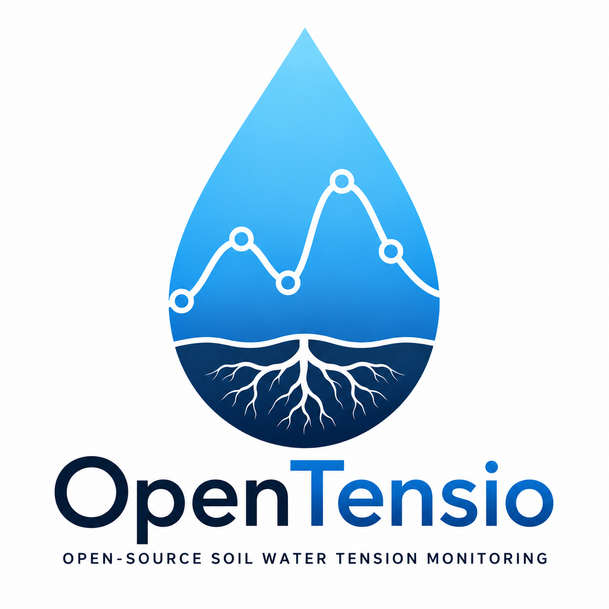

<p align="center">
  
</p>

# OpenTensio

**Open-source soil water tension monitoring**

*ESP32 • LoRa • Wi-Fi • MQTT • Home Assistant*

No cloud • No subscription • Your data stays yours

---

## Why OpenTensio?

OpenTensio is an open-source platform designed to monitor **soil water tension (soil water potential)** using granular matrix sensors.

The objective is simple:

- 🌱 Help growers irrigate more efficiently.
- 🔓 Keep the entire system open and documented.
- ☁️ No mandatory cloud.
- 💳 No subscription.
- 🛠 Repairable and hackable hardware.
- 📡 Open communication protocols.

Your data belongs to **you**.

---

## Features

- ESP32-based nodes
- LoRa long-range field telemetry
- Wi-Fi standalone nodes
- MQTT communication
- Home Assistant integration
- Battery-powered operation
- Deep sleep
- ADS1115 high-resolution ADC
- DS18B20 temperature sensors
- Optional BME280 environmental sensor
- Soil water potential (centibars)
- Battery monitoring
- LoRa RSSI & SNR diagnostics

---

## Architecture

```text
                     LoRa
               ┌─────────────────┐
               │                 │
               │ OpenTensio Node │
               │                 │
               └────────┬────────┘
                        │
                        ▼

               ┌─────────────────┐
               │ OpenTensio      │
               │ Gateway         │
               └────────┬────────┘
                        │
                      MQTT
                        │
     ┌──────────────┬──────────────┬───────────────┐
     ▼              ▼              ▼               ▼

Home Assistant   Node-RED      Grafana      Any MQTT client
```

A standalone Wi-Fi node can also publish directly to MQTT without a LoRa gateway.

---

## Current firmware

| Firmware | Description |
|----------|-------------|
| OpenTensio_LoRa_TX | LoRa field node |
| OpenTensio_LoRa_Gateway | LoRa receiver + MQTT gateway |
| OpenTensio_WiFi_Node | Standalone Wi-Fi node |

---

## Current sensors

Supported today:

- Granular matrix sensors (Watermark principle)
- DS18B20
- BME280

Future versions may support additional sensors.

---

## MQTT

OpenTensio uses **MQTT** as its communication protocol.

This means it is **not tied to Home Assistant**.

Compatible with:

- Home Assistant
- Node-RED
- OpenHAB
- Grafana
- InfluxDB
- Custom software
- Any MQTT-compatible application

---

## Current status

Current public release:

**v0.1.0**

This release intentionally keeps the original field-tested protocol.

```text
MC;cb1;cb2;t_box;t_soil;v1;v2;r1;r2;vbat;t_air;h_air;p_air
```

This ensures complete compatibility with existing installations.

Future versions may introduce versioned payloads (`OT1`), MQTT Discovery and additional features.

---

## Repository

```
firmware/
docs/
examples/
hardware/
```

Hardware fabrication files (PCB/Gerbers) are **not published yet**.

---

## License

MIT License

---

## Philosophy

OpenTensio is built around one simple idea:

> Soil data should belong to farmers.

No vendor lock-in.

No subscriptions.

No cloud dependency.

Just open hardware, open software and open protocols.
