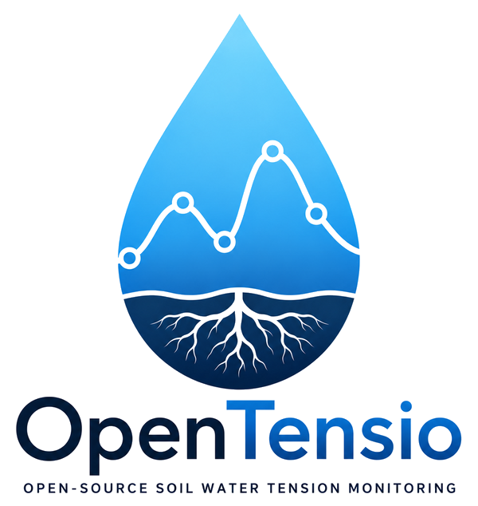
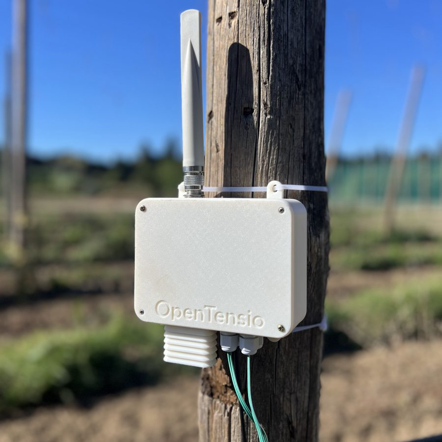
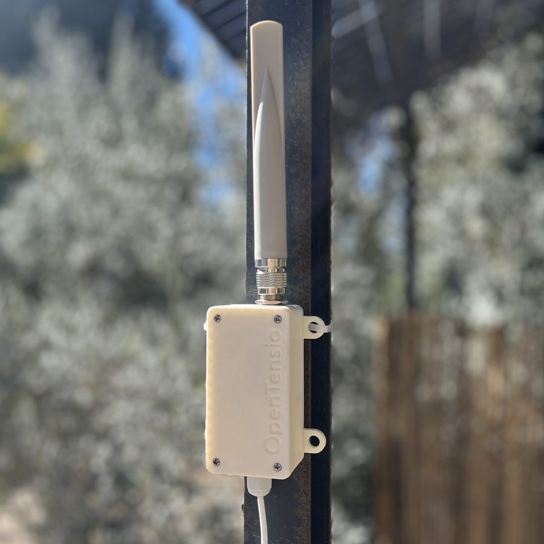
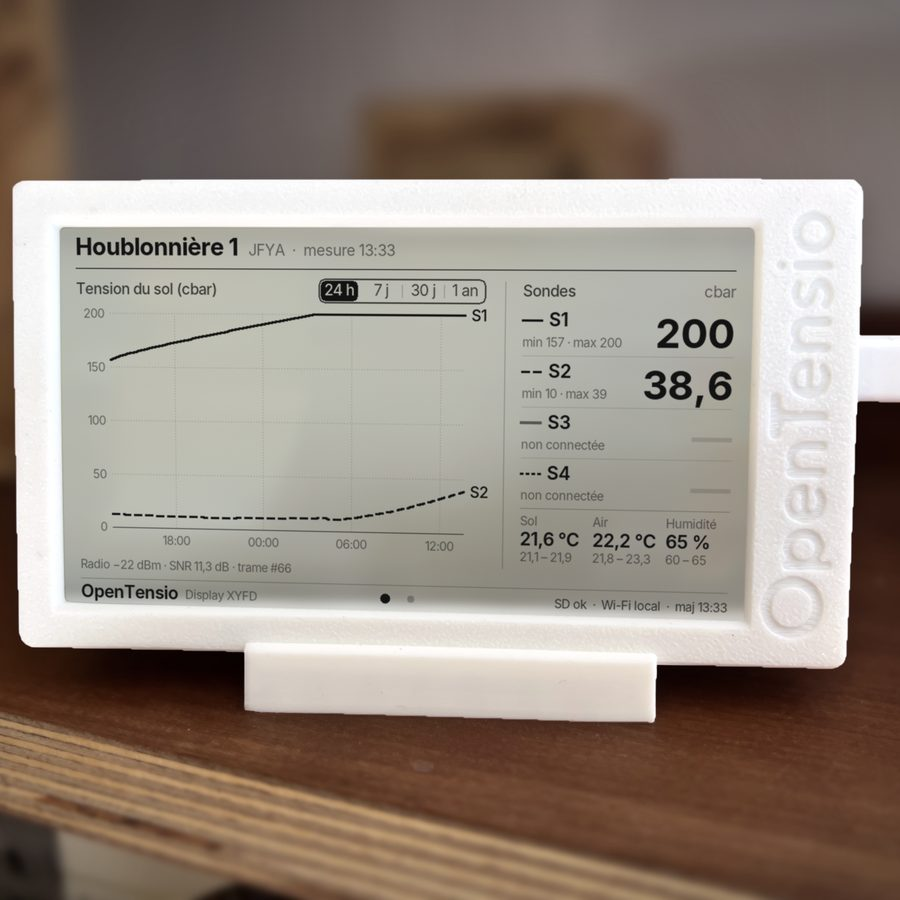

<p align="center">
  
</p>

<p align="center">
  <b>Français</b> · <a href="#english">English</a>
</p>

# OpenTensio

**La tension de l'eau dans le sol, mesurée parcelle par parcelle.**

OpenTensio est un système ouvert de suivi de l'état hydrique du sol pour le pilotage de l'irrigation. Des boîtiers de mesure installés dans les parcelles transmettent leurs données par radio longue portée jusqu'à l'exploitation. Là, elles sont affichées, archivées et consultables localement, sans abonnement ni cloud imposé.

- Présentation : [mascourbet.fr/opentensio](https://mascourbet.fr/opentensio)
- Brochure (PDF, 3 pages) : [`docs/brochure/OpenTensio_brochure.pdf`](docs/brochure/OpenTensio_brochure.pdf)
- Démonstration de l'interface locale : [mascourbet.fr/opentensio/demo](https://mascourbet.fr/opentensio/demo/)

> Projet en phase de tests terrain.

## L'origine du projet

OpenTensio est né sur une houblonnière du Mas Courbet, à Carpentras. Le houblon demande de l'eau, et la question du pilotage de l'irrigation s'est vite posée. Faute d'outil ouvert, sans abonnement et d'un coût raisonnable, il a été construit sur place, puis installé sur les parcelles de l'exploitation.

## Trois boîtiers, une seule chaîne de mesure

| Node | Radio | Display |
|:---:|:---:|:---:|
|  |  |  |
| **Dans la parcelle** | **À l'exploitation** | **Au bureau** |
| Mesure le sol et l'air, émet par radio, puis se met en veille jusqu'à l'heure suivante. | Reçoit les mesures de tous les Nodes, les date à l'heure GPS et les relaie au Display. | Affiche les mesures en continu, archive tout l'historique et publie une page web sur le réseau local. |

```
 Node ──── LoRa 868 MHz ────▶ Radio ──── ESP-NOW ────▶ Display ──▶ écran · carte SD · page web
 mesure toutes les heures     horodate (GPS)           affiche, archive, alerte
```

On équipe les parcelles avec autant de Nodes que nécessaire. Un seul Radio et un seul Display suffisent pour toute l'exploitation. Installation minimale : 1 Node, 1 Radio, 1 Display.

## Ce que mesure chaque Node

- **Tension de l'eau dans le sol** : jusqu'à 4 sondes Watermark à différentes profondeurs, en centibars, de 0 (sol saturé) à 200.
- **Température du sol** : sonde enterrée, qui replace la mesure dans son contexte thermique et sert à corriger les sondes en température.
- **Température et humidité de l'air** : capteur sous abri ventilé, à l'écart du rayonnement direct.

La tension du sol exprime l'effort que doivent fournir les racines pour extraire l'eau. Son évolution montre le dessèchement, la recharge après une pluie ou une irrigation, et aide à apporter la bonne quantité d'eau au bon moment. Le but n'est pas d'irriguer le moins possible, mais d'éviter à la fois les apports inutiles et le stress hydrique.

## Consulter ses mesures

**L'écran e-paper du Display** se lit comme une feuille de papier : courbes de tension et dernières valeurs de chaque sonde, toujours visibles, sans rétroéclairage.

**La page web locale** `http://opentensio.local` s'ouvre depuis n'importe quel téléphone ou ordinateur connecté au Wi-Fi du Display :

- **Nodes** : dernières valeurs, courbes sur 24 h, 7 jours, 30 jours ou un an, export CSV ;
- **Météo** : température et humidité de l'air sur les mêmes périodes ;
- **Configuration** : Wi-Fi de la ferme, MQTT (Home Assistant, Node-RED…), adresse MAC ;
- **Alertes** : abonnement sur le téléphone et seuils par sonde.

Le Display crée son propre Wi-Fi : aucune connexion Internet n'est nécessaire pour consulter ses mesures. Le Wi-Fi de la ferme est facultatif ; il sert à l'heure réseau et aux alertes.

## Météo à la parcelle

Chaque Node est aussi une petite station météo. Il mesure la température et l'humidité de l'air sous abri. L'onglet Météo de la page web présente les courbes sur 24 heures, 7 jours, 30 jours et un an, avec l'historique complet. Il permet de suivre les épisodes de chaleur et de repérer les nuits froides, au plus près de la culture.

## Alertes sur le téléphone

Chaque sonde a deux seuils : **trop sec** (tension au-dessus du seuil haut) et **trop humide** (tension sous le seuil bas). Dès qu'une sonde franchit un seuil, une notification arrive sur le téléphone, puis une autre au retour à la normale. Le Display prévient aussi quand un Node ne donne plus de nouvelles.

Les notifications passent par [ntfy](https://ntfy.sh), une application libre et gratuite pour iPhone et Android, sans compte ni abonnement. On s'abonne en scannant le QR code affiché par la page web du Display.

## Principes

Une technologie ouverte plutôt qu'un service fermé. Le code source et les formats de données sont ouverts : le fonctionnement peut être audité, adapté ou amélioré.

- **Logiciel libre** : les firmwares du Node, du Radio et du Display, et les formats de données, sont ouverts.
- **Un outil que vous maîtrisez** : fonctionnement et schéma documentés ; on comprend, on répare, on fait évoluer.
- **Local par conception** : pas de cloud imposé, tout reste utilisable sans Internet.
- **Vos données** : fichiers CSV documentés, conservés chez vous et librement exportables.

## OpenTensio évolue

Le logiciel s'enrichit régulièrement, et une nouvelle génération de Node est en cours de développement : davantage de sondes par point de mesure et de nouveaux capteurs utiles au suivi des cultures. Les mises à jour se font sans changer d'installation.

## Contenu du dépôt

| Chemin | Contenu |
|---|---|
| [`docs/brochure/`](docs/brochure/) | Brochure de présentation (PDF) |
| [`docs/img/`](docs/img/) | Logo et photos des boîtiers |
| [`firmware/`](firmware/) | Firmwares de la première génération (v0.1.0 : Node LoRa → passerelle MQTT). Les firmwares Node, Radio et Display actuels y seront ajoutés. |

## Licences

- **Code** : [GNU GPL v3](LICENSE).
- **Documentation, brochure, photos** : [CC BY-SA 4.0](https://creativecommons.org/licenses/by-sa/4.0/deed.fr).
- Le nom et le logo **OpenTensio** restent réservés.

## Contact

© 2026 Olivier Blarquez · Mas Courbet, Carpentras · blarquez@gmail.com

---

<a id="english"></a>

# OpenTensio (English)

**Soil water tension, measured field by field.**

OpenTensio is an open system for monitoring soil water status to guide irrigation. Measurement units installed in the fields send their data by long-range radio back to the farm, where it is displayed, archived and available locally, with no subscription and no mandatory cloud.

- Overview (in French): [mascourbet.fr/opentensio](https://mascourbet.fr/opentensio)
- Brochure (PDF, French): [`docs/brochure/OpenTensio_brochure.pdf`](docs/brochure/OpenTensio_brochure.pdf)
- Demo of the local web interface: [mascourbet.fr/opentensio/demo](https://mascourbet.fr/opentensio/demo/)

> The project is currently in field testing.

## Where it comes from

OpenTensio started in a hop yard at Mas Courbet, in Carpentras (southern France). Hops need water, and the question of how to manage irrigation came up quickly. With no open, subscription-free and reasonably priced tool available, one was built on site and installed in the farm's fields.

## Three units, one measurement chain

| Unit | Where | Role |
|---|---|---|
| **Node** | In the field | Measures soil and air, transmits by radio, then sleeps until the next hour. |
| **Radio** | At the farm | Receives measurements from every Node, timestamps them with GPS time and relays them to the Display. |
| **Display** | In the office | Shows the measurements continuously, archives the full history and serves a web page on the local network. |

```
 Node ──── LoRa 868 MHz ────▶ Radio ──── ESP-NOW ────▶ Display ──▶ screen · SD card · web page
 measures every hour          timestamps (GPS)         displays, archives, alerts
```

Add as many Nodes as the fields need; a single Radio and a single Display serve the whole farm. Minimum setup: 1 Node, 1 Radio, 1 Display.

## What each Node measures

- **Soil water tension**: up to 4 Watermark sensors at different depths, in centibars, from 0 (saturated soil) to 200.
- **Soil temperature**: buried probe, used to put the measurement in thermal context and to temperature-correct the sensors.
- **Air temperature and humidity**: sensor in a ventilated shield, away from direct sunlight.

Soil water tension expresses how hard roots must work to extract water. Its evolution shows drying, recharge after rain or irrigation, and helps apply the right amount of water at the right time. The goal is not to irrigate as little as possible, but to avoid both unnecessary watering and water stress.

## Viewing the data

**The Display's e-paper screen** reads like a sheet of paper: tension curves and the latest value of each sensor, always visible, no backlight.

**The local web page** `http://opentensio.local` opens on any phone or computer connected to the Display's Wi-Fi:

- **Nodes**: latest values, curves over 24 h, 7 days, 30 days or one year, CSV export;
- **Weather**: air temperature and humidity over the same periods;
- **Configuration**: farm Wi-Fi, MQTT (Home Assistant, Node-RED…), MAC address;
- **Alerts**: phone subscription and per-sensor thresholds.

The Display creates its own Wi-Fi network: no Internet connection is needed to see your data. The farm Wi-Fi is optional and is used for network time and alerts.

## Field-level weather

Each Node is also a small weather station: it measures air temperature and humidity in a shield. The Weather tab of the web page shows curves over 24 hours, 7 days, 30 days and one year, with the full history. It helps follow heat episodes and spot cold nights, right next to the crop.

## Phone alerts

Each sensor has two thresholds: **too dry** (tension above the high threshold) and **too wet** (tension below the low threshold). When a sensor crosses a threshold, a notification arrives on the phone, followed by another when it returns to normal. The Display also warns when a Node stops reporting.

Notifications go through [ntfy](https://ntfy.sh), a free and open app for iPhone and Android, with no account and no subscription. Subscribe by scanning the QR code shown on the Display's web page.

## Principles

An open technology rather than a closed service. Source code and data formats are open: the system can be audited, adapted or improved.

- **Free software**: the Node, Radio and Display firmware and the data formats are open.
- **A tool you control**: operation and schematic are documented; you can understand it, repair it and make it evolve.
- **Local by design**: no mandatory cloud, everything works without Internet.
- **Your data**: documented CSV files, kept on site and freely exportable.

## OpenTensio keeps evolving

The software is improved regularly, and a new generation of Node is under development: more sensors per measurement point and new sensors useful for crop monitoring. Updates do not require changing the installation.

## Repository contents

| Path | Contents |
|---|---|
| [`docs/brochure/`](docs/brochure/) | Presentation brochure (PDF, French) |
| [`docs/img/`](docs/img/) | Logo and photos of the units |
| [`firmware/`](firmware/) | First-generation firmware (v0.1.0: LoRa Node → MQTT gateway). Current Node, Radio and Display firmware will be added here. |

## Licences

- **Code**: [GNU GPL v3](LICENSE).
- **Documentation, brochure, photos**: [CC BY-SA 4.0](https://creativecommons.org/licenses/by-sa/4.0/).
- The **OpenTensio** name and logo are reserved.

## Contact

© 2026 Olivier Blarquez · Mas Courbet, Carpentras, France · blarquez@gmail.com
